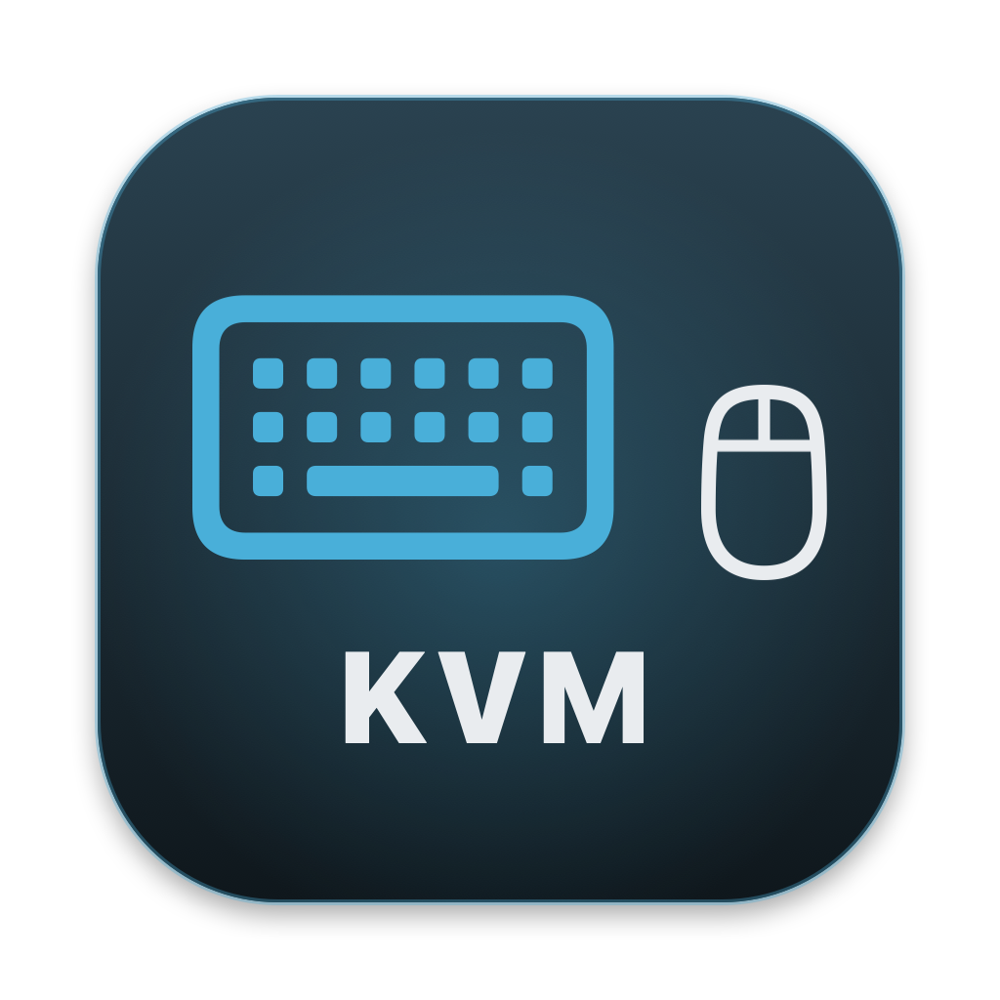

<p align="center">
  
</p>

<h1 align="center">KVM Dashboard</h1>

<p align="center">
  A native macOS app that shows several GL.iNet Comet (GLKVM) remote consoles in one window.<br>
  Built for the home lab: four ESX hosts, four KVMs, one screen.
</p>

---

## Why this exists

I run a GL.iNet Comet KVM on each ESX host in my home lab ([Home Lab | GLiNET Comet KVM](https://www.vcrocs.info/home-lab-glinet-comet-kvm.html)). Each KVM has its own web console, so watching all four hosts meant four browser windows tiled by hand.

KVM Dashboard puts every console in one window: a 2 × 2 grid by default, with full screen for any single host when you need to work on it.

<!-- TODO: add a screenshot of the app at docs/images/kvm-dashboard.png -->

---

## Features

- **All your KVM consoles in one window.** Layouts: 2 × 2, 1 row, 1 column, or Auto.
- **Per-pane controls.** Reload, open in browser, maximize in window, and full screen.
- **Settings (⌘,).** Add, remove, rename, re-point, show or hide, and re-order consoles by dragging or with arrows.
- **Sessions survive changes.** Re-ordering or switching layouts does not reload a console or log you out.
- **Logins persist.** Log in to each KVM once; the session is kept between launches.
- **VMware Clarity / Aria Operations dark theme** with Light and System options. The theme is passed through to the KVM pages too.
- **Self-signed certificates handled.** The app trusts the certificate only for the hosts you configured.
- **Export / Import** the configuration as JSON to move it between Macs.

---

## Requirements

| Requirement | Notes |
| --- | --- |
| macOS 14 Sonoma or later | Tested on macOS 27.0.1, Apple silicon |
| Xcode Command Line Tools | `xcode-select --install`. Full Xcode is **not** required |
| GL.iNet Comet KVM (or any GLKVM device) | Tested on firmware V1.10.1 (RM1 and RM1V2) |
| Network access to the KVMs | Same LAN, or a remote-access tool such as Twingate or a VPN |

---

## Build and install

Clone the repo, then build:

```bash
git clone https://github.com/dalehassinger/KVM.git
cd KVM
mac/build.sh
```

The app is created at `mac/build/KVM Dashboard.app`.

Copy it to Applications (quit the app first if it is running):

```bash
rm -rf "/Applications/KVM Dashboard.app" && cp -R "mac/build/KVM Dashboard.app" /Applications/
```

Because you built it on your own Mac, it opens without a Gatekeeper prompt. The build is ad-hoc signed, not notarized. If you copy the app to another Mac, clear the quarantine flag there once:

```bash
xattr -dr com.apple.quarantine "/Applications/KVM Dashboard.app"
```

---

## First run

1. Open **KVM Dashboard**.
2. macOS asks to allow the app to find devices on your local network. Click **Allow**. Without this, no console can connect.
3. Log in to each pane with that KVM's own credentials. The login is remembered.
4. Open **Settings (⌘,)** and change the four default URLs (`https://192.168.100.141` – `.144`) to your own KVM addresses.

The app never stores your KVM passwords. Each console keeps its own session cookie in the app's WebKit data store, exactly as Safari would.

---

## Using the dashboard

### Pane header

| Icon | Action |
| --- | --- |
| ↻ | Reload the console |
| ↗ | Open the console in your default browser |
| ▢ | Maximize in the window (click again to go back to the grid) |
| ⤢ | Full screen for that console. Hover the top-right corner for **Exit Full Screen**, or press ⌃⌘F |

Hovering an icon highlights it and shows its name in the pane header.

The dot next to the name shows status: green = loaded, grey = loading, red = error (with a **Retry** button).

### Keyboard shortcuts

| Shortcut | Action |
| --- | --- |
| ⌘, | Settings |
| ⇧⌘R | Reload all consoles |
| ⌃⌘F | Exit full screen |

Keystrokes typed while a console has focus go to that KVM, so click a pane before typing into it.

### Settings

- **KVM consoles.** Edit name and URL (URL changes apply when you press Return), toggle **Show**, re-order with drag or ▲▼, delete with the trash icon, or **Add KVM**.
- **Layout.** 2 × 2, 1 row, 1 column, Auto.
- **Theme.** Dark, Light, System. Also available in the toolbar.
- **Show URL in pane header.**
- **Export… / Import…** a JSON file, and **Reset to Defaults**.

Example export:

```json
{
  "kvms" : [
    { "enabled" : true, "id" : "9C1E5C1A-0000-0000-0000-000000000001", "name" : "ESX-01", "url" : "https://192.168.100.141/#/" },
    { "enabled" : true, "id" : "9C1E5C1A-0000-0000-0000-000000000002", "name" : "ESX-02", "url" : "https://192.168.100.142/#/" }
  ],
  "layout" : "2 × 2",
  "showURL" : true,
  "theme" : "Dark"
}
```

---

## Home lab tips

- **Give each KVM a DHCP reservation** so the URLs in the dashboard never change.
- **Match the pane names to your hosts** (ESX-01 … ESX-04) so you always know which console you are typing into.
- **Power each KVM from a neighbouring host's USB port** to avoid extra power bricks in the rack. Remember a KVM then depends on that neighbour being powered on.
- **Remote access.** The app only needs the KVM URLs to be reachable. It works over Twingate, Tailscale, or a VPN just as it does on the LAN.
- **Set the KVM EDID to your display's resolution** in each Comet's own settings for the sharpest image when a pane goes full screen.

---

## Why a native app and not a web page?

The first version was a single static HTML page with four iframes. The panes stayed blank. The GLKVM web app requires a login, and inside an iframe on another page its session cookies and storage are treated as third-party, so browsers block them and the console never starts.

A native app with one WebKit view per console avoids this: each console is a top-level page, just like opening it in its own browser tab. It also lets the app accept each KVM's self-signed certificate for that host only, which a web page cannot do.

The original `index.html` is still in the repo for reference. It works only with consoles that do not require a login.

---

## Troubleshooting

| Symptom | Fix |
| --- | --- |
| Every pane shows an error or stays grey | **System Settings → Privacy & Security → Local Network** → enable **KVM Dashboard** |
| One pane shows a red dot | Check that KVM is powered and reachable: `curl -kI https://<kvm-ip>/` |
| Old icon in Dock or Finder | Quit the app, then `killall Dock` |
| Want to start fresh | `defaults delete com.vcrocs.kvmwall`, then relaunch |
| Something else in a console looks wrong | Right-click inside the pane → **Inspect Element** to open Web Inspector |

---

## Project layout

```
KVM/
├── README.md
├── index.html                  # original static web version (iframes; see above)
├── docs/images/                # README images
└── mac/
    ├── build.sh                # builds "KVM Dashboard.app" with swiftc
    ├── Info.plist              # bundle settings, local network + mic descriptions
    ├── AppIcon.icns            # generated app icon
    ├── Sources/
    │   └── KVMDashboard.swift  # the whole app (SwiftUI + WKWebView)
    └── tools/
        ├── make-icon.swift     # draws the icon
        └── make-icon.sh        # regenerates AppIcon.icns
```

To change the icon, edit `mac/tools/make-icon.swift`, run `mac/tools/make-icon.sh`, then `mac/build.sh`.

> **Note for contributors:** the app builds with the Command Line Tools only. Those do not include the SwiftUI macro plugin, so the code uses a small `Box` `ObservableObject` with `@StateObject` instead of `@State`.

---

## Credits

- Built by [Dale Hassinger](https://www.vcrocs.info) with help from Claude Code.
- Source: [github.com/dalehassinger/KVM](https://github.com/dalehassinger/KVM). Issues and suggestions welcome.
- Hardware write-up: [Home Lab | GLiNET Comet KVM](https://www.vcrocs.info/home-lab-glinet-comet-kvm.html).
- Not affiliated with GL.iNet or Broadcom/VMware. "VMware Clarity" refers only to the colour palette used for the theme.
